# Quy tắc nghiệp vụ và sơ đồ luồng

Phiên bản 1.0 — 05/10/2026, cập nhật quyết định ngày 13/10/2026. Các quyết định đã chốt và giả định còn lại được phân biệt tại [README](README.md). Tất cả thời điểm lưu UTC, hiển thị Asia/Saigon. Dưới đây là thiết kế mục tiêu; hiện trạng mã và kiểm thử xem [báo cáo rà soát](17_RA_SOAT_TOAN_DU_AN_2026_10_13.md).

## 1. Quy tắc

Gợi ý sản phẩm đã chốt: ưu tiên cùng danh mục/thương hiệu/khoảng giá gần; chỉ sản phẩm công khai có SKU còn hàng; loại sản phẩm đang xem; hiển thị lý do phù hợp; không dùng ML. Công thức điểm ở BR-14 vẫn là đề xuất, không phải trọng số đã được người dùng duyệt.

| Mã | Quy tắc |
|---|---|
| BR-01 | CUSTOMER chỉ thao tác dữ liệu mình. Đã chốt 14/10/2026: STAFF/ADMIN dùng tài khoản CUSTOMER riêng khi mua; tài khoản quản lý không dùng giỏ hoặc đặt/thanh toán đơn mua cá nhân. Khóa tài khoản vô hiệu mọi phiên; auth_version là cơ chế kỹ thuật đề xuất. |
| BR-02 | Đã chốt: STAFF tạo nháp, nhập thông tin/ảnh/cấu hình/tồn; ADMIN đặt giá/công bố/ẩn; nháp không công khai. Công bố cần tên, danh mục, thương hiệu, mô tả, ít nhất một ảnh hợp lệ, đủ thông số bắt buộc và ít nhất một SKU bật bán có mã riêng, giá > 0. Hết hàng vẫn được công bố, hiển thị “Hết hàng”, không cho đặt SKU hết hàng. |
| BR-03 | Đã chốt: giỏ chưa giữ hàng; tạo đơn thành công mới giữ; bàn giao mới xuất; hủy trước bàn giao giải phóng lượng giữ. Thiết kế: available = on_hand - reserved; tạo đơn tăng reserved; bàn giao giảm cả on_hand và reserved; hủy giảm reserved. Hết hạn/nhận hàng trả về và chi tiết transaction/movement là phần thiết kế cần rà soát tiếp. |
| BR-04 | Server tính subtotal, discount và phí; total = subtotal - discount + shipping_fee. Bản đầu không hỗ trợ đơn miễn phí: tổng giảm tối đa subtotal-1 VND, luôn total>0. Snapshot tên/SKU/cấu hình/giá/địa chỉ/khuyến mãi/phí không đổi sau tạo đơn. Báo giá đổi phải xác nhận lại. |
| BR-05 | Checkout UNIQUE(user_id,request_key); cùng nội dung trả đơn cũ, khác nội dung bị conflict. Callback UNIQUE(provider,event_id); trạng thái terminal không đảo ngược bởi event cũ. |
| BR-06 | Đã chốt ngày 13/10/2026: CUSTOMER chỉ hủy đơn của mình khi chờ xác nhận; N/Q hủy trước bàn giao, phải ghi lý do. Thiết kế ánh xạ lần lượt PENDING và PENDING/CONFIRMED/PREPARING; SHIPPING không hủy trực tiếp. Đã thu tiền thì ghi khoản cần hoàn (REFUND_PENDING), không tự đánh dấu đã hoàn. |
| BR-07 | COD có thể xác nhận khi UNPAID; ONLINE phải PAID mới CONFIRMED. Đã chốt ngày 14/10/2026: ONLINE có hạn 15 phút từ lúc tạo đơn, thử lại không gia hạn; hết hạn chưa thu thì CANCELLED và giải phóng giữ tồn. Thành công đã xác minh thì tiếp tục xử lý; thành công đến sau hủy ghi khoản cần hoàn, không mở lại đơn. Thời hạn này không áp dụng COD. |
| BR-08 | Callback success muộn ghi nhận tiền nhưng không mở lại đơn; REFUND_PENDING và ngoại lệ cho ADMIN. Callback thất bại sau success không lùi PAID. |
| BR-09 | Tạo vận đơn chưa phải giao hàng. SHIPPING chỉ khi bàn giao thực tế; DELIVERED chưa phải thu COD. Đã chốt ngày 14/10/2026: giao thất bại phải ghi lý do, có thể giao lại; chỉ cộng kho khi cửa hàng xác nhận đã nhận hàng trả về. Trường hợp trả về đã thu tiền thì ghi khoản cần hoàn, không tự đánh dấu đã hoàn. |
| BR-10 | Đã chốt ngày 14/10/2026: tối đa một mã/đơn, không cộng dồn; chỉ giảm tiền hàng, không giảm phí giao; kiểm tra thời hạn, giá trị đơn tối thiểu và giới hạn lượt; lưu mức giảm trên đơn, không thay đổi khi chương trình được sửa. Chi tiết thiết kế chưa chốt riêng: FIXED/PERCENT có trần, thời gian [start,end), minimum theo subtotal, phạm vi PRODUCT/ALL; HELD+USED tính limit, hủy trước bàn giao RELEASED, bàn giao USED, thất bại sau bàn giao không tự trả lượt. |
| BR-11 | Đã chốt ngày 14/10/2026: chủ đơn đã nhận hàng (DELIVERED) được đánh giá; một đánh giá mỗi dòng sản phẩm trong đơn, gồm 1–5 sao và nhận xét; khách được sửa đánh giá của mình; ADMIN duyệt trước công khai, sửa phải duyệt lại. Thiết kế tính điểm trung bình chỉ từ đánh giá APPROVED. |
| BR-12 | Đã chốt ngày 14/10/2026: chỉ tính doanh thu tiền hàng cho đơn đã giao và đã thanh toán (DELIVERED/PAID), bằng subtotal-discount, không gồm phí giao; đơn hủy/giao thất bại không tính. Tiền thu, tiền hoàn và phí giao hiển thị riêng. Chi tiết thiết kế: recognition_at là thời điểm điều kiện cuối đạt; thu/hoàn dựa ledger theo occurred_at; thu trừ hoàn không gọi là lợi nhuận. |
| BR-13 | Không xóa giao dịch/đối tượng được tham chiếu; ẩn/khóa. Audit ghi người/nguồn, thời gian, lý do, trước/sau đã che nhạy cảm; không cung cấp chức năng sửa/xóa. |
| BR-14 | So sánh đã chốt: tối đa 3 SKU cùng danh mục; giá/cấu hình/thông số chuẩn, đánh dấu khác biệt, thiếu ghi “Chưa có thông tin”; hết hàng vẫn so sánh, bị ẩn không so sánh. Gợi ý theo quy tắc cơ bản thuộc phạm vi tài liệu gốc; công thức đề xuất chưa chốt: cùng danh mục +50, thương hiệu +20, giá lệch <=20% +10; xếp tiếp theo lượng đã giao và ID. |
| BR-15 | Đã chốt ngày 14/10/2026: mỗi đơn một kiện, một mã vận đơn, giao toàn bộ sản phẩm cùng lúc; chưa hỗ trợ chia đơn/giao từng phần. Phí giao cố định do ADMIN cấu hình, khách thấy trước khi đặt; đơn đã tạo giữ nguyên phí. Biểu phí khu vực/trọng lượng thuộc phần mở rộng; số tiền phí cụ thể và địa bàn phục vụ chưa chốt. |
| BR-16 | Thiết kế mở rộng: tác vụ tích hợp dùng job bền vững, retry giữ request_key; timeout phải đối soát trước tạo yêu cầu mới. Bản thủ công không gọi API hãng; tác vụ hết hạn online nội bộ vẫn cần xử lý độc lập và không đồng nghĩa có worker tích hợp đã hoạt động. |

## 2. Ma trận chuyển trạng thái

### Đơn hàng

| Từ | Sang | Nguồn/điều kiện | Tồn/tiền |
|---|---|---|---|
| Mới | PENDING | UC-18 | Giữ tồn; giữ lượt mã |
| PENDING | CONFIRMED | N/Q; COD hoặc ONLINE PAID | Không đổi tồn |
| CONFIRMED | PREPARING | N/Q | Không đổi tồn |
| PREPARING | SHIPPING | UC-26 bàn giao có vận đơn | Tiêu thụ reservation; lượt mã USED |
| SHIPPING | DELIVERED | G xác thực hoặc N/Q thủ công | Không tự thu COD |
| PENDING | CANCELLED | Chủ đơn, N/Q hoặc hết hạn ONLINE chưa thu | Giải phóng giữ; hoàn tiền nếu có |
| CONFIRMED/PREPARING | CANCELLED | N/Q; chưa bàn giao | Giải phóng giữ; hoàn tiền nếu có |
| SHIPPING | DELIVERY_FAILED | Đã nhận lại hàng, shipment RETURNED | Cộng kho một lần; tiền thu cần hoàn |

CANCELLED/DELIVERED/DELIVERY_FAILED là terminal trong phạm vi này. Đổi trả sau giao thuộc mở rộng. Không sửa tay trạng thái để vượt điều kiện.

### Thanh toán đơn và attempt

- Đơn: UNPAID → PENDING khi tạo attempt ONLINE; PENDING → PAID khi verified success; PENDING → UNPAID khi FAILED/hết hạn mà chưa thu; UNPAID/PENDING → REFUND_PENDING nếu tiền success đến khi đơn đã hủy; PAID → REFUND_PENDING khi hủy/giao thất bại; REFUND_PENDING → REFUNDED khi hoàn đủ.
- COD: đã chốt ngày 14/10/2026, UNPAID → PAID chỉ khi ADMIN xác nhận thu đủ tiền qua UC-24, kèm mã chứng từ và ghi chú. STAFF cập nhật giao hàng không được xác nhận tiền; DELIVERED không tự chuyển PAID. Hủy COD chưa thu giữ UNPAID.
- Attempt: CREATED → PENDING → SUCCEEDED/FAILED; CREATED/PENDING → EXPIRED khi quá hạn. Verified success muộn từ FAILED/EXPIRED vẫn ghi SUCCEEDED và xử lý ngoại lệ, vì tiền thật có thể đã thu; không suy luận thành công từ trang redirect.
- payment_exception ghi nghĩa vụ hoàn của khoản thu muộn/trùng. Nếu đơn hợp lệ đã PAID và thu dư thêm, vẫn PAID, khoản dư xử lý riêng; không cộng thu dư vào doanh thu hàng. REFUNDED là tiền đã thu cho đơn hủy đã hoàn hết, không phải mọi đơn đều phải đi qua trạng thái này.

### Vận chuyển

- CREATED → READY khi có mã vận đơn; READY → IN_TRANSIT khi bàn giao; IN_TRANSIT → DELIVERED hoặc FAILED; FAILED → IN_TRANSIT khi giao lại; FAILED → RETURNED khi hàng thực về.
- CREATED/READY → CANCELLED khi đơn hủy trước bàn giao. Bản thủ công: nhân viên liên hệ hãng ngoài website nếu cần hủy; ghi trạng thái không chứng minh đã hủy với hãng. Job/API hủy hãng thuộc mở rộng.
- Callback không có sequence tin cậy dùng timestamp nhà cung cấp + trạng thái hiện tại, tra cứu khi mâu thuẫn; không coi thời gian nhận HTTP là thứ tự nghiệp vụ.

## 3. Luồng đăng ký, đăng nhập và khóa tài khoản — UC-01..05

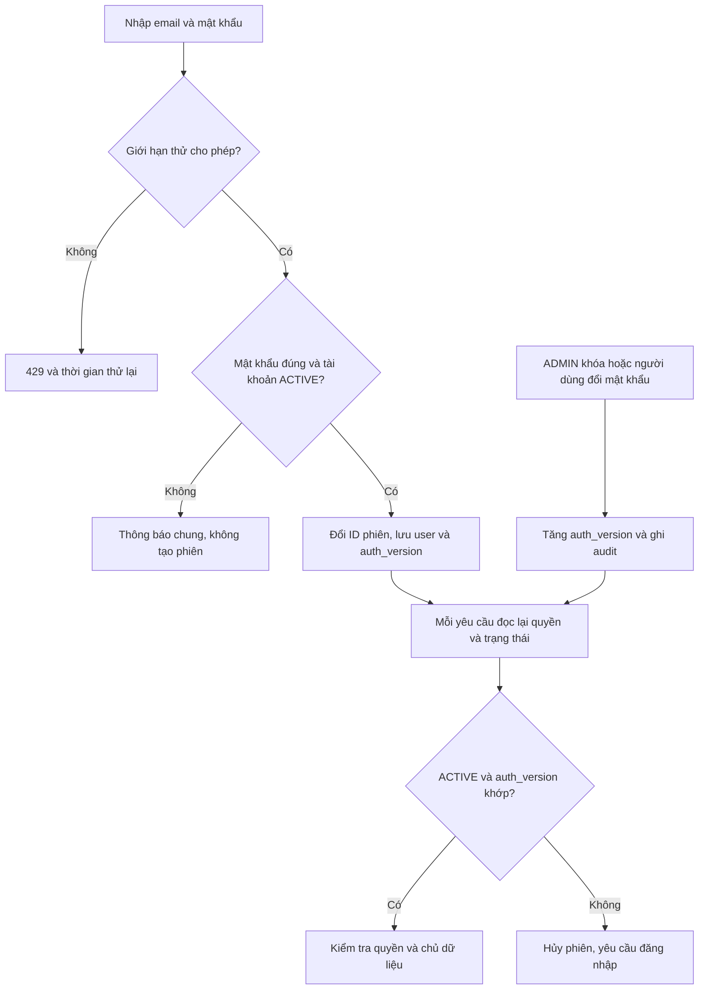

Đăng ký: validate → email unique → hash → CUSTOMER ACTIVE → đăng nhập UC-02; không tiếp nhận role từ khách.

## 4. Luồng sản phẩm, giá và công bố — UC-08..13

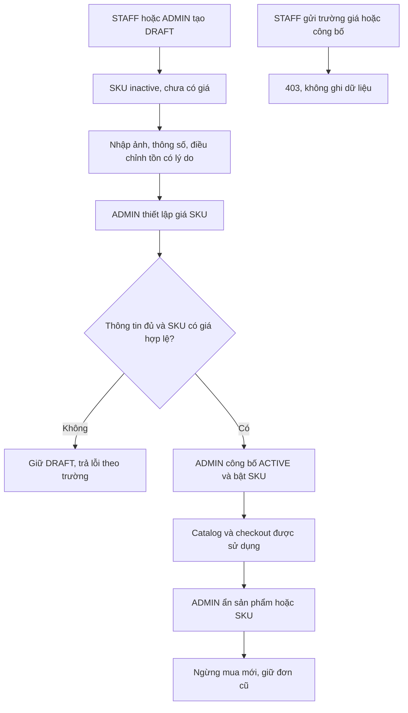

## 5. Luồng mua hàng — UC-16..26

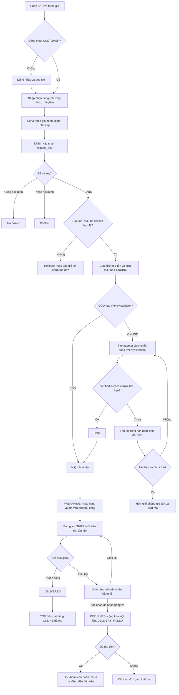

## 6. Luồng hủy/hết hạn và callback muộn — UC-20,21,23,34

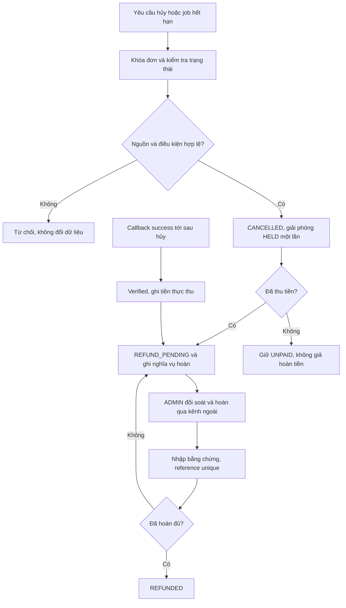

Job hết hạn và callback success phải khóa cùng đơn. Nếu success được commit trước job, job không hủy; nếu job hủy trước success, success không khôi phục hàng.

Sau PAID, deadline không giải phóng reservation: hàng giữ tới hủy hoặc bàn giao. Tác vụ hết hạn chỉ chọn đơn ONLINE PENDING chưa thu, không quét hạn reservation độc lập. Bản vận chuyển thủ công: khi hủy đơn có shipment READY, ghi hủy bản vận đơn nội bộ trong cùng giao dịch; nhân viên liên hệ hãng ngoài website nếu cần và lưu thông tin xác nhận. Trạng thái nội bộ không chứng minh hãng đã hủy; không tự gọi API. Job hủy, đối soát kết quả tạo đến muộn và job bù thuộc phần mở rộng ở tài liệu 27.

## 7. Sơ đồ trạng thái đơn

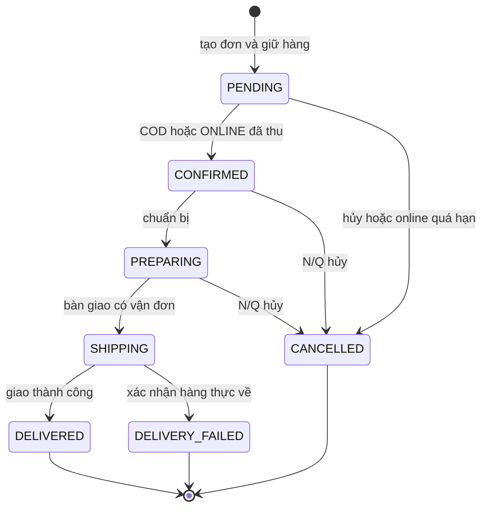

## 8. Sơ đồ trạng thái vận chuyển

Chú giải hình trạng thái đơn ở mục 7: “online quá hạn” chỉ đơn ONLINE chưa thanh toán sau 15 phút từ tạo đơn, không áp dụng COD. N/Q chỉ hủy trước bàn giao; khách chỉ hủy đơn của mình khi PENDING. DELIVERY_FAILED chỉ khi xác nhận đã nhận hàng trả về, không phải ngay lần giao thất bại.

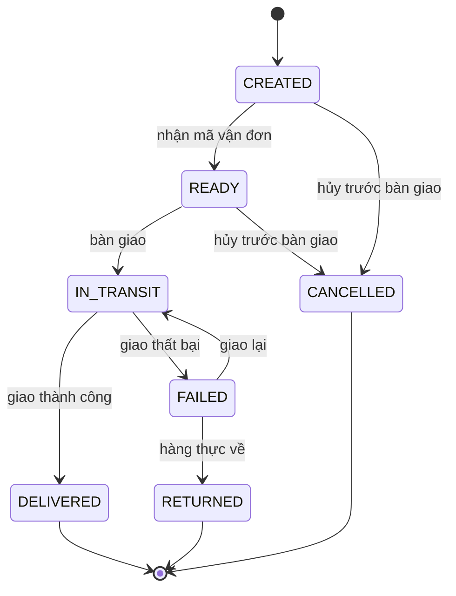

## 9. Sơ đồ tuần tự đặt hàng và thanh toán

### 9.1. Luồng VNPay sandbox tối thiểu

Đây là thiết kế cho phạm vi chính, chưa phải kết quả nghiệm thu. Server lưu tham chiếu và tạo URL có chữ ký theo cấu hình sandbox; không bắt buộc có worker tạo URL. Trạng thái tiền chỉ cập nhật từ kết quả cổng được xác thực, không từ việc khách quay lại.

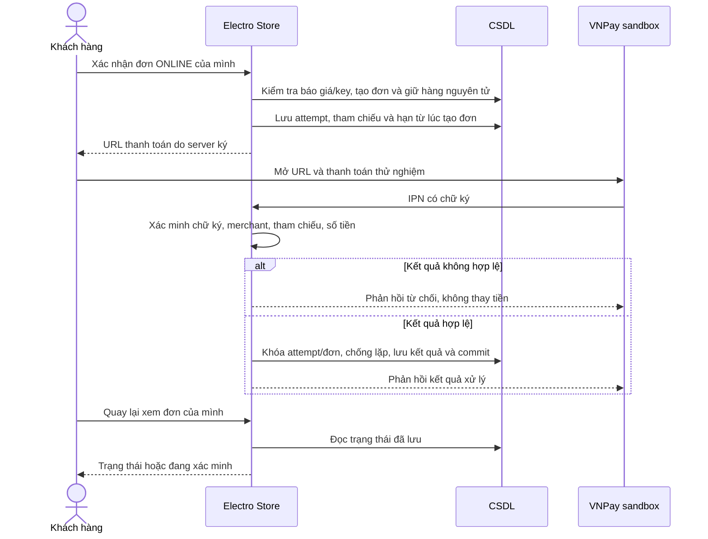

Thất bại/timeout chưa là thành công; thiếu IPN cần được đối soát, không tự đoán. Hết hạn 15 phút chưa thu hủy/giải phóng giữ; thành công đến sau hủy ghi khoản cần hoàn, không mở lại đơn. Giới hạn attempt và querydr chủ động là thiết kế cần hoàn thiện riêng.

### 9.2. Kiến trúc worker mở rộng

Sequence bên dưới giữ làm phương án kiến trúc, không phải yêu cầu bắt buộc tạo URL ở luồng 9.1 hoặc xác nhận worker đã hoạt động. Jobs ở tài liệu 27; tác vụ hết hạn nội bộ vẫn cần kể cả không dùng hàng đợi tích hợp.

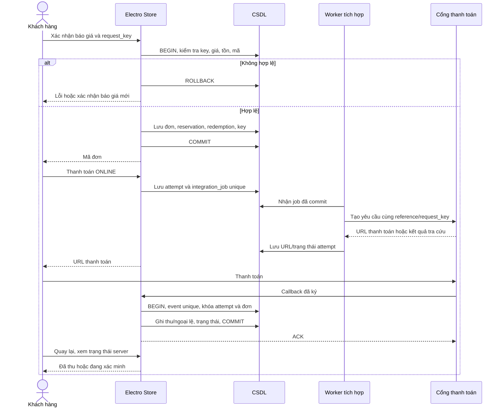

## 10. Sơ đồ tuần tự giao hàng và COD

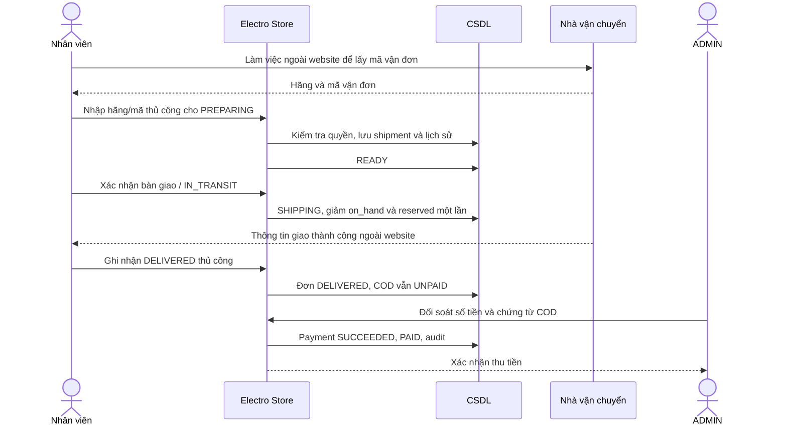

## 11. Luồng khuyến mãi, đánh giá và hỗ trợ

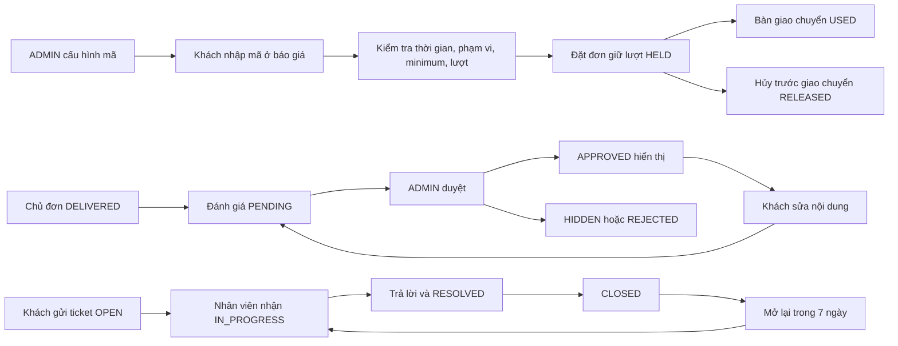

## 12. Sơ đồ dữ liệu báo cáo

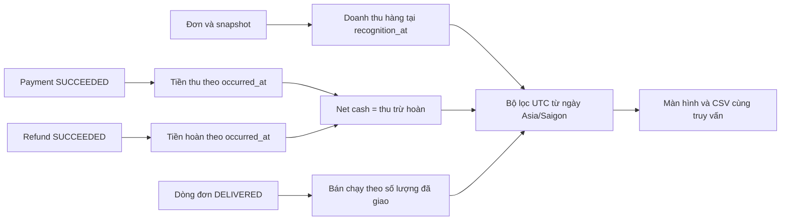

Báo cáo hiển thị riêng doanh thu hàng, phí giao, giảm giá, tiền thu, tiền hoàn và khoản chờ hoàn; không cộng callback như một khoản thu mới. Trường hợp thu dư không tạo thêm doanh thu hàng.

## 13. Sơ đồ trạng thái thanh toán của đơn

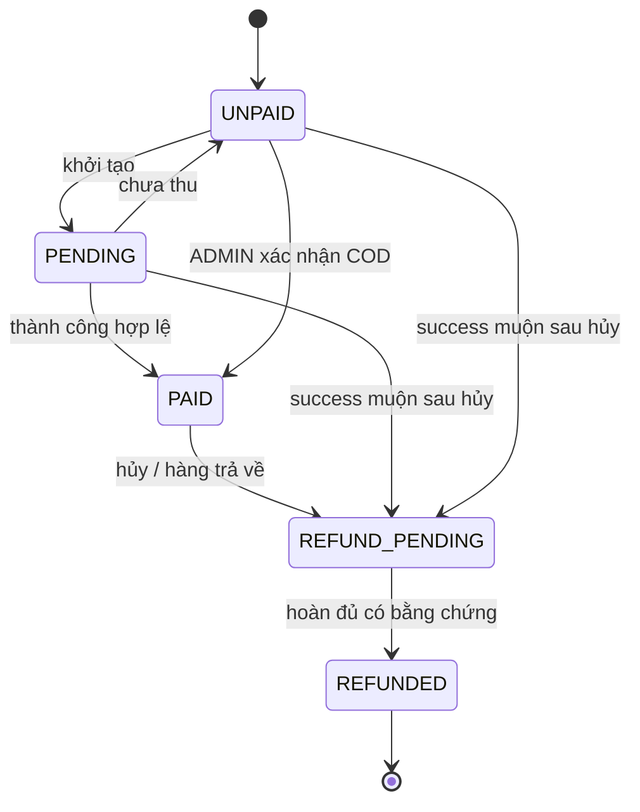

PAID không terminal: có thể cần hoàn khi hủy. Khoản thu dư sau PAID là payment_exception độc lập, không làm mất trạng thái khoản thu hợp lệ.

Chú giải nhãn rút gọn: “khởi tạo” là tạo attempt ONLINE; “chưa thu” là kết quả thất bại hoặc hết hạn chưa có khoản thu xác minh; “thành công hợp lệ” là kết quả cổng đã xác thực và đơn còn hợp lệ. “Hàng trả về” chỉ khi đã xác nhận nhận lại hàng, không phải ngay lần giao thất bại. COD chỉ PAID khi ADMIN đối soát đủ; REFUNDED chỉ sau hoàn đủ có bằng chứng. Số tiền trong sandbox là dữ liệu thử nghiệm.
