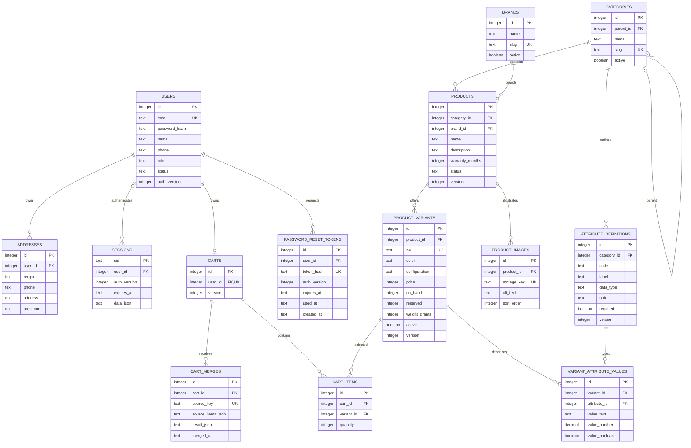
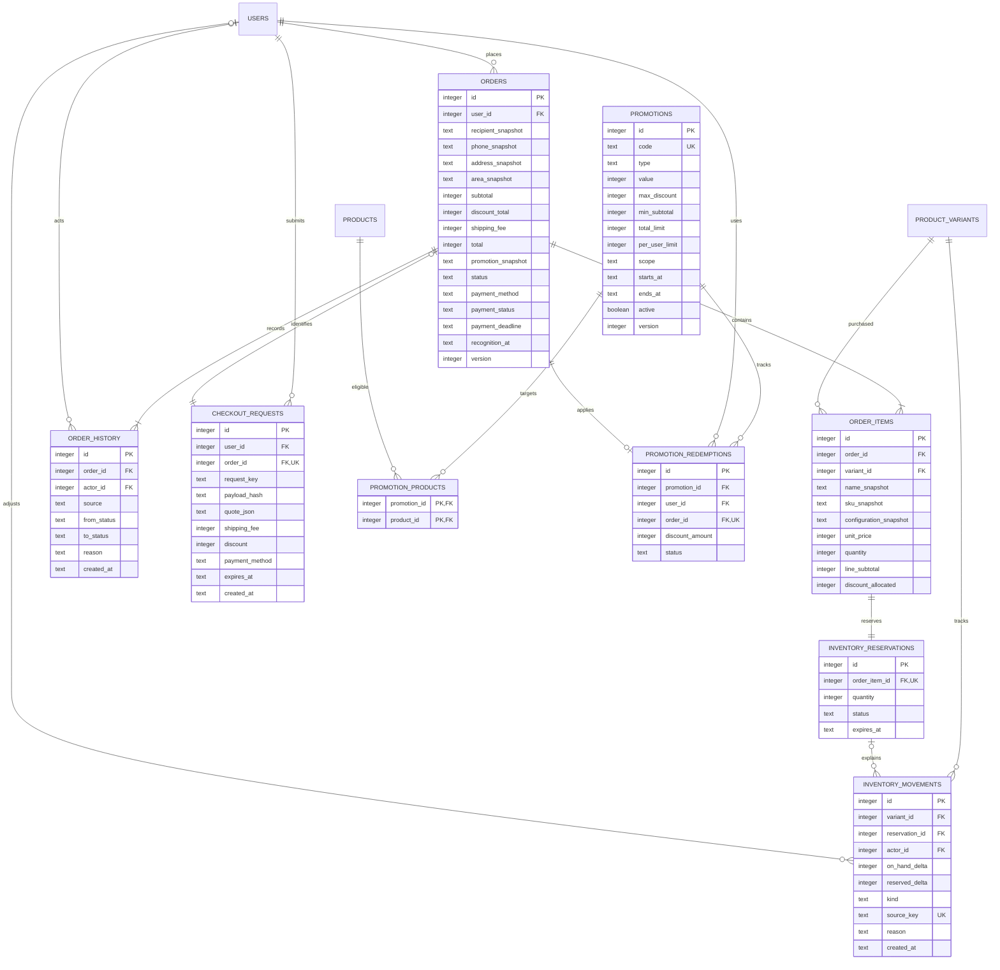
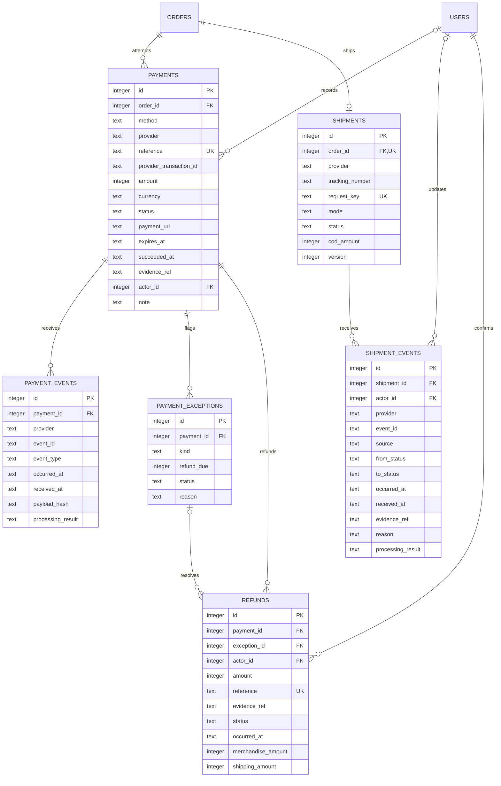
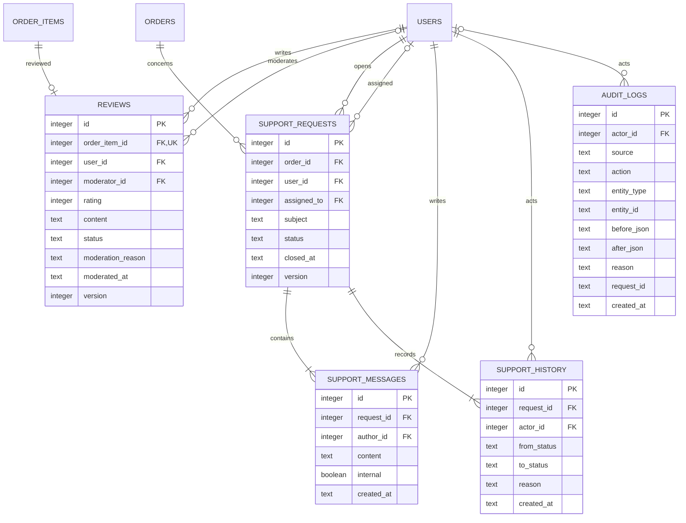

# ERD và từ điển dữ liệu toàn hệ thống

Phiên bản 1.0 — 05/10/2026. Mô hình quan hệ mục tiêu, **chưa phải schema SQLite hiện tại**. Phù hợp các UC-01..34 và BR-01..16. ERD chia theo module để đọc được; tên bảng nối giữa các sơ đồ là cùng một bảng, không phải bản sao. PK/FK/UK lần lượt là khóa chính/ngoại/unique.

Ghi nhận schema v9/v2 là mốc lịch sử. Lần rà soát ngày 13/10/2026 thấy mã có migration SQLite v11/PostgreSQL v4; xem [báo cáo hiện trạng](17_RA_SOAT_TOAN_DU_AN_2026_10_13.md). Mô hình dưới đây vẫn là mục tiêu. Bản đồ án đã chốt phí cố định và vận chuyển thủ công; shipping_rates và API hãng thuộc mở rộng. Tài liệu được chỉnh từng nhóm, chưa xác nhận mọi nhóm đã đồng bộ.

## 1. ERD tài khoản, giỏ hàng và catalog

Quy trình hỗ trợ đã chốt: yêu cầu gắn với đơn/chủ khách, có trạng thái mới/đang xử lý/đã đóng; tin nhắn phân biệt công khai/nội bộ. Khi rà soát nhóm hỗ trợ trong ERD, bảo đảm liên kết chủ yêu cầu với chủ đơn và trường phân loại nội bộ; không chỉ ẩn tin ở giao diện mà phải lọc dữ liệu theo quyền. Cách đặt tên bảng/cột là thiết kế kỹ thuật.

Thông số theo danh mục đã chốt: ADMIN quản lý ATTRIBUTE_DEFINITIONS (kiểu dữ liệu, đơn vị khi phù hợp, bắt buộc); STAFF nhập VARIANT_ATTRIBUTE_VALUES theo từng SKU; so sánh dùng chung định nghĩa và giá trị này. Thiết kế cần kiểm tra mỗi giá trị thuộc định nghĩa của đúng danh mục sản phẩm, đúng kiểu và duy nhất theo cặp SKU/định nghĩa; thiếu dữ liệu không được tự coi là số 0.

Quên mật khẩu đã chốt: liên kết email có hạn 30 phút, dùng một lần; thành công vô hiệu mọi phiên cũ, giữ giỏ/lịch sử đơn. PASSWORD_RESET_TOKENS dưới đây bổ sung dữ liệu reset mục tiêu; không lưu token rõ.

Đã chốt thêm ngày 14/10/2026: đăng nhập CUSTOMER gộp giỏ vãng lai vào giỏ tài khoản một lần, cộng số lượng cùng SKU; vượt tồn/giới hạn phải báo để khách điều chỉnh trước đặt. Cần thiết kế giao dịch và dấu xử lý giỏ nguồn để retry/tải trang không cộng lại. Đây là yêu cầu thiết kế, chưa xác nhận schema/mã đã hỗ trợ.

Giỏ CUSTOMER lưu theo tài khoản và tồn tại qua đăng xuất/đăng nhập lại; kiểm tra giá/tồn trước đặt. Gộp giỏ vãng lai một lần đã chốt; CART_MERGES là thiết kế dấu chống gộp lặp, không phải bảng đã triển khai. Mã hiện lưu giỏ trong phiên, cần điều chỉnh sau tài liệu. Xóa phiên không xóa giỏ tài khoản.

Vãng lai không có CARTS trong CSDL: giỏ được lưu trong data_json của phiên. CUSTOMER có tối đa một giỏ, giữ sau logout. SKU nháp cho phép price NULL, nhưng active=1 phải có price hợp lệ. DRAFT có thể chưa có SKU; ACTIVE phải có ít nhất một SKU active.

### 1.1. Ràng buộc catalog/SKU sau rà soát

- Mỗi sản phẩm thuộc một danh mục và một thương hiệu; mỗi danh mục/thương hiệu có thể chưa có sản phẩm. Mỗi SKU/ảnh thuộc đúng một sản phẩm; bản nháp có thể chưa có SKU hoặc ảnh.
- SKU có mã duy nhất, giá riêng và tồn riêng. Giá có thể NULL khi nháp, nhưng bật bán phải có giá > 0. Tồn vật lý và giữ hàng không âm, reserved <= on_hand; available được tính, không lưu thêm để tránh lệch.
- Công bố kiểm tra tên/danh mục/thương hiệu/mô tả, ảnh hợp lệ, ít nhất một SKU bật bán có mã/giá hợp lệ. Mọi SKU bật bán phải đủ thông số bắt buộc của danh mục; SKU nháp chưa đủ không được đưa vào các cấu hình mua. Đây là cách cụ thể hóa điều kiện công bố đã chốt.
- Hết tồn không làm đổi sản phẩm sang nháp/ẩn; khả năng mua xét từng SKU. Công bố và còn hàng là hai điều kiện độc lập.
- Mỗi định nghĩa thông số thuộc một danh mục, code duy nhất trong danh mục; mỗi cặp SKU/định nghĩa có tối đa một giá trị. Phải đúng danh mục và đúng kiểu TEXT/NUMBER/BOOLEAN; số 0 và boolean false là giá trị có thật, không phải thiếu.
- Quyền theo nghiệp vụ: ADMIN quản lý định nghĩa và giá/công bố/ẩn; STAFF nhập thông tin/ảnh/thông số/tồn. FK không thay thế kiểm tra quyền và điều kiện công bố.
- category.parent_id, products.warranty_months và variant.weight_grams thuộc thiết kế mở rộng/chưa chốt chi tiết; không bắt buộc trọng lượng cho checkout phí cố định. Cột tồn tại trong mã không làm tăng phạm vi nghiệp vụ đã thống nhất.
- Không xóa SKU/sản phẩm làm mất lịch sử đơn; đơn giữ snapshot. Quy tắc sửa mã SKU/đổi danh mục/ngừng dùng catalog cần rà soát riêng.

## 2. ERD đơn hàng, kho, checkout và khuyến mãi

CHECKOUT_REQUESTS lưu báo giá và khóa theo CUSTOMER trước tạo đơn; order_id/payload_hash nullable khi chưa thành công. Mỗi request liên kết tối đa một đơn; mỗi đơn trong luồng checkout có một request thành công. UNIQUE(user_id,request_key) và order_id UNIQUE chống tạo trùng. Thất bại tạo đơn rollback đơn, giữ kho và kết quả request; báo giá đã phát hành có thể còn để thử lại khi hợp lệ. Không giữ kho chỉ vì phát hành báo giá. expires_at của báo giá là chi tiết thiết kế riêng, không đồng nhất với hạn online 15 phút tính từ tạo đơn.

SHIPPING_RATES được tách sang [ERD mở rộng](27_ERD_MO_RONG_VA_LUONG_TICH_HOP.md). Bản đồ án lấy phí cố định từ cấu hình ADMIN và lưu shipping_fee vào báo giá/đơn; không cần trọng lượng hoặc rate_id để đặt hàng.

### 2.1. Ràng buộc đơn hàng và kho

- ORDERS thuộc CUSTOMER; ORDER_ITEMS không rỗng, mỗi dòng có SKU, số lượng và snapshot tên/mã/cấu hình/giá. Thay dữ liệu catalog không sửa lịch sử mua.
- subtotal là tổng tiền hàng, discount_total là mức giảm đã chốt, total = subtotal - discount_total + shipping_fee. Không lấy tổng từ browser; sửa phí/mã trước xác nhận phải phát hành báo giá mới, không sửa đơn đã tạo.
- Một dòng đơn có một reservation cùng số lượng: HELD khi tạo, CONSUMED khi bàn giao, RELEASED khi hủy trước bàn giao, RETURNED khi đã xuất và xác nhận hàng về. Mỗi chuyển chỉ ảnh hưởng kho một lần.
- source_key duy nhất trên movement chống ghi lặp; thay trạng thái, kho, lịch sử và kết quả checkout cùng giao dịch. Không cộng tồn khi mới báo giao thất bại.
- Hủy không xóa đơn/dòng/lịch sử; tiền đã thu được xử lý ở nhóm thanh toán riêng. payment_deadline NULL cho COD, online = thời điểm tạo đơn + 15 phút.
- Cách giữ/trả lượt khuyến mãi và phân bổ giảm theo dòng còn là thiết kế cần rà soát riêng, không coi là đã chốt từ việc đồng ý một mã/đơn.

## 3. ERD thanh toán, vận chuyển và tích hợp

Bản đồ án: COD đối soát bởi ADMIN, VNPay sandbox, vận chuyển thủ công một kiện/mã mỗi đơn. REFUNDS là dữ liệu ghi nhận hoàn tiền, không phải lệnh tự động hoàn ngân hàng. INTEGRATION_JOBS và các trường callback hãng trong sơ đồ là thiết kế nền tảng/mở rộng, không bắt buộc gọi API để hoàn thành luồng vận chuyển thủ công.

Tích hợp có nhiều attempt theo đơn nhưng chỉ một attempt ONLINE CREATED/PENDING đồng thời. COD có tối đa một payment thu tiền theo đơn. Một payment có nhiều callback, nhưng một khoản thu chỉ được ghi một lần theo provider_transaction_id. PAYMENTS.amount là số tiền thực được nhà cung cấp xác thực; không đổi đơn để khớp khoản tiền sai.

### 3.1. Ràng buộc thanh toán và vận chuyển thủ công

- Số tiền/tiền tệ phải khớp giao dịch dự kiến; không chuyển PAID chỉ từ return trình duyệt. Với sandbox, thành công là giao dịch thử nghiệm, không gọi là khoản thu thật. actor_id nullable cho sự kiện cổng, bắt buộc khi ADMIN ghi COD; chứng từ và ghi chú COD bắt buộc.
- PAYMENT_EVENTS lưu kết quả đã xác thực, chống callback trùng; timeout/thất bại không được ghi thành công giả. Deadline online tính từ tạo đơn +15 phút, không gia hạn khi thử lại; sau khi đã xác minh thu thành công không tự hủy do deadline.
- Thành công đến sau hủy hoặc khoản thu dư tạo nghĩa vụ xử lý hoàn, không mở lại đơn hoặc tăng doanh thu tiền hàng. Không ghi REFUNDED chỉ vì tạo PAYMENT_EXCEPTIONS.
- REFUNDS liên kết khoản thu; có số tiền, tham chiếu/bằng chứng và thời điểm. Không vượt nghĩa vụ/tiền thu hoặc ghi lặp; chỉ đánh dấu đã hoàn khi có kết quả hợp lệ. Chi tiết quyền ghi hoàn, hoàn toàn phần/từng phần và phân bổ hàng/phí còn cần chốt riêng, không suy ra từ quyền xác nhận COD.
- Một đơn có tối đa một SHIPMENTS, bắt buộc có mã trước bàn giao. Thiết kế UNIQUE(provider,tracking_number) ngăn dùng cùng mã của hãng cho hai đơn. mode=MANUAL trong bản đồ án; không tạo vận đơn qua API trong luồng chính.
- STAFF/ADMIN ghi trạng thái với actor, thời điểm, lý do thất bại và thông tin xác nhận; dữ liệu demo phải ghi rõ. Có vận đơn chưa phải đã xuất kho; bàn giao mới xuất, giao thành công không tự thu COD.
- FAILED có thể giao lại; chỉ xác nhận hàng đã nhận về mới hoàn kho một lần. Thay trạng thái vận đơn/đơn, kho và lịch sử phải nguyên tử; không dùng cập nhật tay bỏ qua điều kiện.
- Không lưu thông tin thẻ hoặc bí mật ký cổng trong dữ liệu sự kiện, chứng từ hoặc audit.

## 4. ERD đánh giá, hỗ trợ và audit

Nhóm này dùng dữ liệu giao dịch đã có, không sao chép lại chủ đơn hoặc trạng thái mua mà không kiểm tra liên kết. Các giới hạn độ dài/tên mã trạng thái là thiết kế kỹ thuật; quyền đánh giá, kiểm duyệt và công khai/nội bộ đã được chốt.

Audit dùng entity_type/entity_id để tham chiếu nhiều loại đối tượng: không coi đây là FK SQL đa hình. Tính tồn tại và quyền kiểm tra ở dịch vụ. Không cần bảng REPORTS hay RECOMMENDATIONS: tính từ giao dịch/catalog; CSV là đầu ra, không phải dữ liệu nghiệp vụ.

### 4.1. Ràng buộc khuyến mãi, đánh giá, hỗ trợ và nhật ký

- PROMOTION_REDEMPTIONS liên kết chương trình, đơn và chủ đơn; order_id UNIQUE bảo đảm tối đa một mã mỗi đơn. Đơn giữ mức giảm đã áp dụng, sửa chương trình không đổi snapshot. Kiểm tra hạn, tối thiểu và lượt trong giao dịch đặt để không vượt hạn mức khi đồng thời.
- PROMOTION_PRODUCTS mô tả phạm vi sản phẩm nếu chọn kiểu giới hạn; loại FIXED/PERCENT, trần và cách giữ/trả lượt vẫn là đề xuất, không coi tất cả đã phê duyệt từ quy tắc một mã/đơn.
- REVIEWS tham chiếu dòng đơn duy nhất và chủ đơn đã nhận hàng; rating 1–5. user_id phải khớp orders.user_id qua order_items; FK riêng lẻ không đủ kiểm tra điều kiện này. Sửa cùng bản đánh giá, không thêm bản thứ hai; sửa chuyển chờ duyệt, chỉ APPROVED công khai.
- Moderator phải là ADMIN; lưu người và thời điểm duyệt. Thêm moderated_at nullable vào từ điển mục tiêu; không giả người duyệt cho dữ liệu cũ.
- SUPPORT_REQUESTS thuộc một đơn và CUSTOMER chủ đơn; assigned_to nullable, nếu có phải STAFF/ADMIN. Trạng thái chính OPEN → IN_PROGRESS → CLOSED. Mở lại/RESOLVED là đề xuất mở rộng chưa chốt, không bắt buộc bản luồng đã thống nhất.
- Tin SUPPORT_MESSAGES có internal; khách chỉ tạo/nhận tin công khai. Quyền phải được lọc ở dữ liệu trả về, không chỉ ẩn nút/khối HTML. SUPPORT_HISTORY giữ người/thời điểm/chuyển trạng thái, không để khách thấy ghi chú nội bộ qua lịch sử.
- AUDIT_LOGS lưu tác nhân/hành động/đối tượng/thời điểm; không sửa/xóa qua nghiệp vụ quản trị thông thường. before/after che mật khẩu, token và bí mật tích hợp; ghi chú tự do không được nhập bí mật. Retention/xuất audit chưa chốt riêng.

## 5. Quy ước từ điển dữ liệu

- ID integer tự sinh; sid/reference/request_key/event_id là chuỗi opaque do hệ thống/nhà cung cấp tạo, không dùng số thứ tự làm bí mật.
- Các bảng nghiệp vụ có created_at/updated_at UTC nếu cần sửa; ledger/history/event/audit chỉ có created_at hoặc occurred_at và append-only. ERD không lặp mọi timestamp để giữ sơ đồ đọc được.
- Các trường FK mặc định NOT NULL; trường optional được nêu ở bảng dưới. role là enum CUSTOMER/STAFF/ADMIN, không cần roles/user_roles vì mỗi tài khoản đúng một vai trò trong phạm vi này.
- text enum dùng CHECK; boolean dùng 0/1; tiền/đếm/khối lượng integer, không dùng số thực để tính tiền. value_number có thể dùng số thập phân cho thông số kỹ thuật, không dùng cho giá.
- before_json/after_json/data_json có cấu trúc JSON được validate và che trường nhạy cảm; password_hash không được ghi vào audit hoặc xuất báo cáo.

| Bảng | Ý nghĩa, null và ràng buộc bổ sung |
|---|---|
| users | email normalized UNIQUE; phone nullable; status ACTIVE/LOCKED; auth_version >= 1. Không xóa user có giao dịch. |
| addresses | Địa chỉ thuộc một user; area_code ánh xạ cấu hình giao hàng; sửa địa chỉ không đổi snapshot order. |
| sessions | user_id/auth_version nullable cho vãng lai; expires_at bắt buộc; lưu cart vãng lai, CSRF và báo giá; cookie chỉ chứa sid đã ký. |
| carts | user_id UNIQUE và phải là CUSTOMER; version >=1; một giỏ tài khoản, không xóa khi logout/đổi/reset mật khẩu. |
| cart_items | UNIQUE(cart_id,variant_id); quantity 1–99. Xóa dòng giỏ được phép; không xóa SKU được tham chiếu. |
| password_reset_tokens | user_id bắt buộc; token_hash UNIQUE, không lưu token rõ; expires_at = thời điểm phát hành + 30 phút; used_at nullable khi chưa dùng. Thiết kế kiểm tra auth_version lúc phát hành; dùng token/lưu mật khẩu/tăng auth_version nguyên tử. Chính sách gửi lại chưa chốt riêng. |
| cart_merges | Thiết kế đề xuất: source_key opaque UNIQUE cho một giỏ nguồn, không dùng lại khi chuyển tài khoản; cart_id bắt buộc; lưu snapshot nguồn/kết quả không chứa bí mật. Ghi dấu và gộp trong cùng giao dịch; retry không cộng lại. Nếu lượng mong muốn vượt 99, giữ thông tin cần điều chỉnh trong result_json thay vì âm thầm bỏ; chi tiết giao diện xử lý còn cần thiết kế. |
| categories | parent_id nullable; slug UNIQUE; cấm tự làm cha hoặc vòng; không hard-delete khi còn product/attribute/child. |
| brands | slug UNIQUE; inactive không cho tạo sản phẩm mới, không tự ẩn hàng cũ. |
| products | status DRAFT/ACTIVE/HIDDEN; warranty_months >=0, nullable nếu chưa xác định; version >=1; không tự xóa sản phẩm khi ẩn danh mục. |
| product_variants | sku UNIQUE; quy tắc sửa mã sau mua cần rà soát riêng; color/configuration nullable; price nullable khi inactive; on_hand>=reserved>=0; weight_grams optional cho bản phí cố định, nếu có phải >0; version >=1. |
| product_images | storage_key UNIQUE, không đường dẫn từ khách; sort_order>=0; ảnh dùng cho product, không bắt buộc có ảnh riêng từng SKU. |
| attribute_definitions | UNIQUE(category_id,code); data_type TEXT/NUMBER/BOOLEAN; unit nullable cho TEXT/BOOLEAN; required dùng lúc công bố. |
| variant_attribute_values | UNIQUE(variant_id,attribute_id); đúng một value_* NOT NULL khớp kiểu; thuộc tính phải thuộc category của SKU; FK đơn thuần không đủ, cần kiểm tra dịch vụ/trigger. |
| orders | recipient/phone/address/area snapshot NOT NULL; subtotal>0, 0<=discount_total<subtotal, shipping_fee>=0, total=subtotal-discount_total+shipping_fee>0; status theo 06; method COD/ONLINE; deadline nullable cho COD; recognition_at nullable trước đủ điều kiện. |
| order_items | quantity 1–99, unit_price>0; line_subtotal=unit_price*quantity; 0<=discount_allocated<=line_subtotal; UNIQUE(order_id,variant_id). Tổng dòng phải khớp subtotal/discount trong giao dịch. |
| order_history | actor_id nullable khi SYSTEM/PROVIDER; from_status nullable chỉ lúc tạo; source USER/SYSTEM/PROVIDER; reason bắt buộc cho hủy/ngoại lệ. |
| inventory_reservations | order_item_id UNIQUE; quantity khớp dòng đơn; status HELD/CONSUMED/RELEASED/RETURNED; expires_at nullable cho COD. RETURNED chỉ từ CONSUMED. |
| inventory_movements | reservation_id/actor_id nullable cho điều chỉnh/hệ thống; source_key UNIQUE bảo đảm một movement mỗi sự kiện; kind ADJUST/HOLD/RELEASE/CONSUME/RETURN; hai delta không cùng 0. |
| checkout_requests | UNIQUE(user_id,request_key), order_id UNIQUE; payload_hash gồm cart, giá báo, địa chỉ, phí, mã, phương thức; không hash mật khẩu/token. |
| shipping_rates | min_weight>=0, max_weight>min_weight; weight trong [min,max); fee>=0; hiệu lực [starts,ends), ends nullable; dịch vụ cấm nhiều rate active cùng địa bàn/trọng lượng/thời gian chồng nhau. |
| promotions | code normalized uppercase UNIQUE; type FIXED/PERCENT; value>0; PERCENT<=100, max_discount>0 bắt buộc PERCENT; FIXED trần nullable; scope ALL/PRODUCT; limits>0; ends>starts; không sửa bản đã dùng ngoài active/ends_at có audit. |
| promotion_products | PK kép; scope PRODUCT cần ít nhất một product; scope ALL không sử dụng dòng phạm vi. |
| promotion_redemptions | order_id UNIQUE bảo đảm một mã/đơn; status HELD/USED/RELEASED; amount khớp discount order; user_id phải khớp chủ order. |
| payments | reference UNIQUE; provider_transaction_id nullable trước thu, UNIQUE(provider,provider_transaction_id) nếu không NULL; amount>0, currency VND; method COD/ONLINE; CREATED/PENDING/SUCCEEDED/FAILED/EXPIRED; evidence_ref bắt buộc COD SUCCEEDED; succeeded_at nullable trước thu. |
| payment_events | UNIQUE(provider,event_id); chỉ xử lý dữ liệu đã xác thực; processing_result ACCEPTED/DUPLICATE/IGNORED/EXCEPTION; event sai không ghi như giao dịch hợp lệ mà vào log bảo mật đã redacted. |
| payment_exceptions | kind LATE_SUCCESS/DUPLICATE_CAPTURE/CANCELLED_PAID/RETURNED_PAID; refund_due>0; status OPEN/RESOLVED; UNIQUE(payment_id,kind); không tạo nghĩa vụ hoàn trùng cho cùng khoản tiền. |
| refunds | exception_id nullable khi hoàn tiền đơn hủy thông thường; reference UNIQUE; amount>0, merchandise_amount+shipping_amount=amount; status SUCCEEDED cho bản đầu; tổng hoàn <= số đã thu chưa hoàn, kiểm tra cùng giao dịch. |
| shipments | order_id UNIQUE; tracking_number nullable khi CREATED, UNIQUE(provider,tracking_number) nếu có; mode API/MANUAL; cod_amount bằng total với COD chưa thu, bằng 0 với ONLINE; trạng thái theo 06. |
| shipment_events | UNIQUE(provider,event_id); actor_id nullable callback; source PROVIDER/USER; evidence_ref bắt buộc cập nhật MANUAL; lưu processing_result cho event cũ/mâu thuẫn. |
| integration_jobs | request_key UNIQUE; status QUEUED/RUNNING/SUCCEEDED/RETRY/FAILED; attempts>=0; last_error redacted; payment_id hoặc shipment_id phù hợp kind; locked_until nullable, lease cho worker; không lưu secret trong job. |
| reviews | order_item_id UNIQUE; user_id=chủ đơn DELIVERED; moderator_id nullable; rating 1–5; status PENDING/APPROVED/HIDDEN/REJECTED; content 1–2000; version >=1. |
| support_requests | user_id=chủ order; assigned_to nullable, chỉ STAFF/ADMIN; luồng chính OPEN/IN_PROGRESS/CLOSED, RESOLVED/mở lại là đề xuất chưa chốt; closed_at nullable trước đóng; subject 1–120; version >=1. |
| support_messages | internal=1 chỉ STAFF/ADMIN tạo/xem; content 1–2000; mỗi ticket có ít nhất tin đầu tiên. |
| support_history | from_status nullable lúc tạo; trạng thái chuyển và lý do giữ lịch sử. |
| audit_logs | actor_id nullable cho SYSTEM/PROVIDER; source/action/entity_type/entity_id bắt buộc; before/after nullable theo action; append-only, che mật khẩu/secret/PII không cần thiết. |

## 6. Công thức và ràng buộc giao dịch

### Tồn kho

| Sự kiện | on_hand_delta | reserved_delta | Reservation |
|---|---|---|---|
| Điều chỉnh vật lý | delta | 0 | Không có |
| Đặt đơn | 0 | +q | HELD |
| Hủy/hết hạn trước giao | 0 | -q | RELEASED |
| Bàn giao | -q | -q | CONSUMED |
| Hàng thực về sau giao thất bại | +q | 0 | RETURNED |

CHECK on_hand>=reserved>=0 không thay thế khóa/giao dịch. Giữ tồn bằng UPDATE có điều kiện available>=q và kiểm tra số dòng ảnh hưởng. Reservation chuyển bằng điều kiện trạng thái cũ + movement source_key UNIQUE; giao dịch rollback nếu một dòng không đủ.

### Giảm giá

- Với scope PRODUCT, eligible_subtotal là tổng các dòng thuộc phạm vi, còn min_subtotal kiểm tra trên toàn giỏ.
- FIXED: min(value,eligible_subtotal). PERCENT: min(floor(eligible_subtotal*value/100),max_discount,eligible_subtotal).
- Sau công thức trên, chặn discount tối đa subtotal-1 VND để bản đầu không tạo đơn tổng 0; báo giá hiển thị số giảm thực áp dụng.
- Phân bổ discount cho các dòng đủ điều kiện theo tỷ lệ line_subtotal; làm tròn xuống, phân bổ phần dư theo line_subtotal giảm dần rồi variant_id. Tổng discount_allocated phải đúng discount_total.
- Tổng lượt sử dụng tính HELD+USED, kiểm tra trong cùng giao dịch với insert redemption. Per-user theo users.id, không dùng cookie/IP.

### Tiền và báo cáo

- payments SUCCEEDED là ledger tiền thu; refunds SUCCEEDED là ledger tiền hoàn. Tổng thu dư không sửa orders.total; payment_exception lưu nghĩa vụ hoàn.
- recognition_at được đặt đúng một lần khi order DELIVERED và payment_status PAID. Doanh thu hàng theo recognition_at; đơn hủy/giao thất bại chưa có recognition không vào doanh thu.
- Báo cáo tiền thu gồm tất cả khoản thực thu, kể cả tiền muộn phải hoàn; hiển thị pending_refund riêng. Net cash trừ refund theo ngày thực hoàn.
- Hoàn tiền bản đầu toàn bộ khoản thu cho đơn hủy/giao thất bại, không hỗ trợ đổi trả một phần. Thu dư hoàn khoản dư; merchandise_amount/shipping_amount cho trường hợp này phân loại theo đối soát, không làm giảm doanh thu hàng hợp lệ đã ghi nhận.

## 7. Index và chiến lược xóa

- Index: orders(user_id,created_at), orders(status,created_at), order_items(order_id), order_history(order_id,id), variants(product_id,active), products(category_id,brand_id,status), reservations(status,expires_at), movements(variant_id,created_at), redemptions(promotion_id,status,user_id), payments(order_id,status), events(payment_id), shipments(status), tickets(status,assigned_to,updated_at), audit(entity_type,entity_id,created_at), jobs(status,next_attempt_at), sessions(expires_at).
- Partial UNIQUE một ONLINE attempt CREATED/PENDING trên order; một COD payment trên order. UNIQUE provider_transaction_id/tracking_number chỉ khi NOT NULL. Chọn cú pháp phù hợp DB khi triển khai.
- ON DELETE RESTRICT với user, product, variant, order, payment, shipment, promotion và ledger đã tham chiếu. Không cascade xóa đơn/tiền/audit.
- CASCADE chỉ cho dữ liệu tạm như cart_items khi xóa cart và thuộc tính/ảnh của bản nháp chưa có giao dịch sau kiểm tra quyền. File ảnh dọn theo job sau commit, không xóa trước transaction.
- Dữ liệu cần giữ lịch sử dùng active/status; dữ liệu cá nhân có quy trình ẩn danh và retention cấu hình riêng, không xóa giao dịch tùy tiện.

## 8. Migration từ schema hiện có

1. Sao lưu CSDL và kiểm tra khôi phục; chốt schema mục tiêu, tạo schema_migrations(version,applied_at).
2. Tách category/brand văn bản thành bảng, chuẩn hóa và ánh xạ rõ ràng; không nhập lại dữ liệu mẫu vào DB thật.
3. Mỗi product hiện có tạo SKU mặc định; giữ giá và active; on_hand ban đầu = stock khả dụng hiện tại + tổng quantity của đơn chưa bàn giao đang giữ, reserved = tổng đang giữ. Các đơn SHIPPING đã trừ kho trong bản cũ không được trừ thêm lần nữa.
4. Tạo reservation HELD cho PENDING/CONFIRMED/PREPARING, CONSUMED cho SHIPPING/DELIVERED, RELEASED cho CANCELLED; lịch sử movement migration có source_key và ghi rõ là số dư chuyển đổi, không giả lịch sử nhập hàng.
5. Ánh xạ order_items vào SKU; giữ name/price/quantity cũ; snapshot cấu hình và phí/giảm trước đó =0 nếu bản demo không có. Không thay giá đơn theo giá SKU mới.
6. COD DELIVERED bản cũ đã PAID không mặc nhiên có chứng từ đối soát: đánh dấu nguồn LEGACY_IMPORT và yêu cầu đối soát trước dùng làm số liệu thật. Không tự tạo payment có bằng chứng giả.
7. Chuyển cart product_id sang variant_id; giỏ MemoryStore cũ không lấy được thì thông báo khách tạo lại. Triển khai persistent session từ thời điểm migration.
8. Đối chiếu số tài khoản/sản phẩm/đơn, tổng tiền từng đơn, available trước/sau; kiểm thử đặt/hủy/giao, callback lặp/muộn. Dừng migration nếu chênh lệch; khôi phục backup theo quy trình.

Không chạy migration trong giai đoạn tài liệu này. Các CHECK liên bảng như quyền chủ đơn, thuộc tính theo danh mục, tổng tiền, lượt mã và transitions cần dịch vụ/trigger cùng transaction, không chỉ thêm FK là đủ.

Biểu phí shipping_rates được nạp qua cấu hình/migration có kiểm tra và audit bởi người triển khai được ADMIN ủy quyền; bản đầu chưa có màn hình quản lý biểu phí riêng. Không nhập số phí tùy ý từ khách hoặc STAFF. Nếu thêm UI cấu hình phí sau này, cần thêm use case ADMIN tương ứng.
