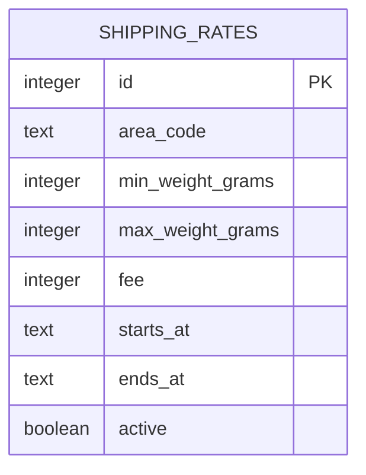
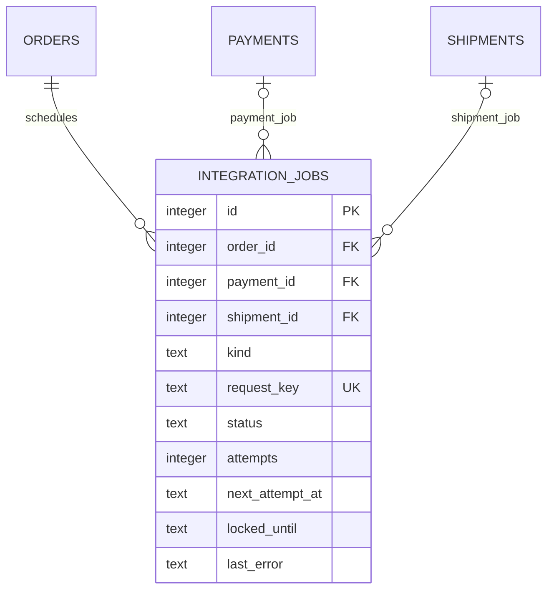

# ERD mở rộng và luồng tích hợp đề xuất

Tách khỏi các hình ERD chính của tài liệu 07. Các bảng có thể đã có nền tảng trong mã; hình này không xác nhận đã triển khai đầy đủ hoặc đã được duyệt toàn bộ.

## 1. Biểu phí khu vực/trọng lượng — mở rộng

Phần mở rộng cần mô hình vùng, khoảng trọng lượng/hiệu lực không chồng và liên kết snapshot báo giá. Không gắn lại quan hệ bắt buộc vào đơn bản phí cố định; đây chưa là ERD hoàn chỉnh cho dịch vụ vận chuyển nâng cao.

## 2. Jobs tích hợp — kiến trúc đề xuất

Quan hệ trên chỉ cho jobs liên quan đơn/tiền/kiện, chưa bao phủ job email reset. Cần thiết kế payload, loại job, lease/chống chạy trùng, trạng thái retry và dữ liệu nhạy cảm trước khi ghép worker.

## 3. Phân biệt luồng chính và mở rộng

| Nội dung | Bản đồ án đã chốt | Thiết kế mở rộng |
|---|---|---|
| Phí giao | Mức cố định ADMIN cấu hình, snapshot đơn | Vùng/trọng lượng/hiệu lực |
| Tạo vận đơn | Nhân viên làm việc ngoài website rồi nhập hãng/mã | API create/query/cancel |
| Trạng thái giao | STAFF/ADMIN nhập có lịch sử | Callback hãng xác thực |
| Thanh toán | VNPay sandbox ký yêu cầu và xác thực kết quả, COD đối soát riêng | Worker/querydr và đối soát chủ động |
| Hết hạn online | Nội bộ xử lý hạn 15 phút, giải phóng giữ đúng một lần | Scheduler/queue bền là lựa chọn triển khai |

Không đưa mọi worker vào phần ngoài phạm vi nghiệp vụ: email và hết hạn online vẫn cần hoạt động; cách dùng queue là kiến trúc có thể bổ sung. Không dùng redirect để xác nhận tiền dù chọn kiến trúc nào.

## 4. Những luồng còn cần chỉnh tiếp

Cập nhật: đoạn hủy vận đơn mục 6 của 06 đã đổi sang liên hệ ngoài website; mục 9.1 bổ sung VNPay tối thiểu, mục 9.2 giữ worker như phương án mở rộng. Các gạch đầu dòng dưới là ghi nhận trước khi chỉnh. Chưa nghiệm thu nhà cung cấp hoặc render hình.

- Mục 6 của tài liệu 06 còn đoạn mô tả job bù/API hủy hãng: chỉ áp dụng mở rộng, không cho rằng cập nhật thủ công gọi được hãng.
- Mục 9 của 06 đã gắn nhãn sequence worker đề xuất; khi xuất báo cáo cần thêm sequence VNPay tối thiểu riêng.
- Một số trường provider/event ở shipment_events giữ để truy vết; trong bản thủ công tác nhân cập nhật là N/Q, không phải callback trực tiếp.

Chưa render sơ đồ hoặc sửa mã. Bước tiếp theo là chỉnh luồng thanh toán tối thiểu và đoạn hủy vận đơn cho thống nhất trước kiểm tra hình cuối.
